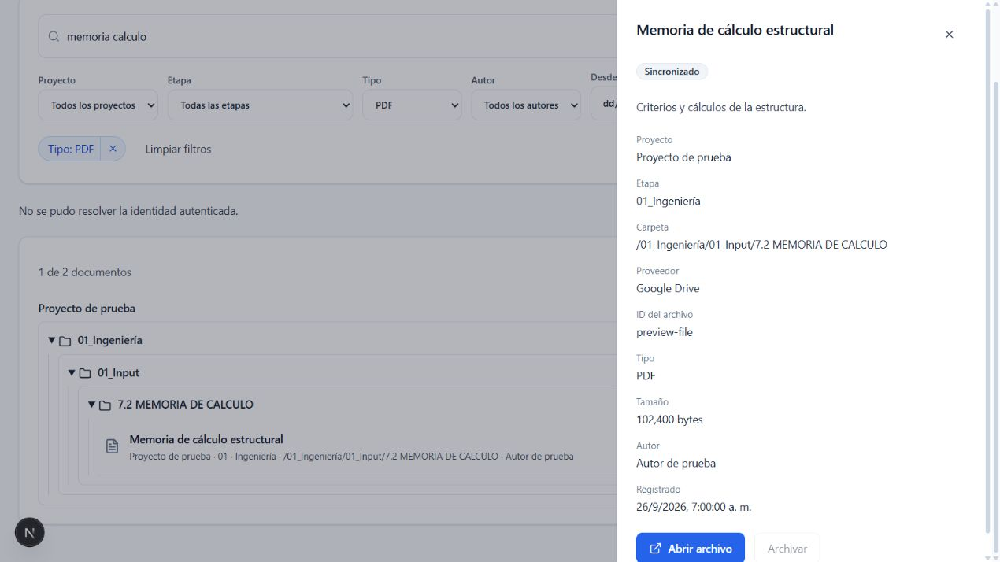

# Tarea 7 — Documentos con buscador

Versión: 0.8.9. Base: Tarea 6, versión 0.8.8.

## Implementado

- Biblioteca general `/app/documents` y biblioteca por proyecto `/app/projects/[projectId]/documents`.
- Búsqueda local sin distinción de tildes o mayúsculas por nombre, descripción, carpeta y autor.
- Filtros combinables por proyecto, etapa, tipo, fecha de registro y autor, con chips removibles.
- Lista y árbol de carpetas anidadas según `folder_path`, agrupados por proyecto.
- Panel lateral accesible con metadatos, enlace al proveedor, estado de sincronización y archivado lógico.
- Registro de referencias con etapa obligatoria, descripción, carpeta e ID real del archivo en Drive/OneDrive.
- Lectura reactiva de Dexie; creación y archivado locales con outbox FIFO. Los cambios locales y tombstones se preservan frente a la instantánea inicial del servidor.
- Paginación de carga de documentos para evitar el antiguo límite de 100 referencias en la biblioteca general.
- La etapa 98 permanece bloqueada para escrituras en la interfaz y en el RPC.

## Backend

Migración `20260926235204_task7_document_search_sync.sql` aplicada al proyecto Supabase MGL Systems. El nombre local coincide con la versión registrada remotamente.

Amplía `public.sync_mutation` para crear y actualizar `stage_id`, `description` y `folder_path`. Mantiene SECURITY INVOKER, RLS, idempotencia, LWW y soft delete. Conserva las ramas de tareas, dependencias y SST.

No cambia el esquema Dexie: los campos e índices requeridos ya existen en su versión 3.

La estructura de carpetas representa las rutas registradas. La conexión OAuth, importación automática y subida de archivos a Drive/OneDrive siguen correspondiendo a la tarea 14. La búsqueda cubre metadatos, no el contenido binario de los archivos.

## Validación

- `npm run typecheck`: PASS.
- `npm run test`: 12 archivos, 42 pruebas PASS.
- `npm run test:documents`: 7 pruebas SQL con PostgreSQL/PGlite PASS.
- `npm run build`: PASS.
- Supabase real: creación, actualización de metadatos, replay idempotente y bloqueo de cotización PASS dentro de BEGIN/ROLLBACK. Todos los datos temporales fueron revertidos; no se editaron los proyectos reales.
- Revisión de seguridad posterior sin hallazgos nuevos respecto del estado anterior.
- Navegador: búsqueda, combinación con tipo, árbol de carpetas y drawer verificados con datos ficticios. La ruta temporal de prueba fue eliminada antes del build final.

`npm run verify` todavía se detiene en el fallo previo de Fase 6: `Valuation snapshots baseline unit price — permission denied for table valuation_items` (56/57 hasta el punto de interrupción; las pruebas posteriores de esa suite no llegan a ejecutarse). El build se comprobó por separado.

La prueba de navegador no utilizó una sesión autenticada real. El registro UI completo y la reconexión offline de extremo a extremo no se verificaron en esa sesión; repositorio/outbox y RPC se probaron por separado.

## Continuación

Siguiente tarea del plan: Tarea 8, buscador global Cmd+K / Ctrl+K.

## Captura de componentes

Datos ficticios en una página temporal sin sesión autenticada; el aviso de identidad corresponde a esa condición de prueba.

